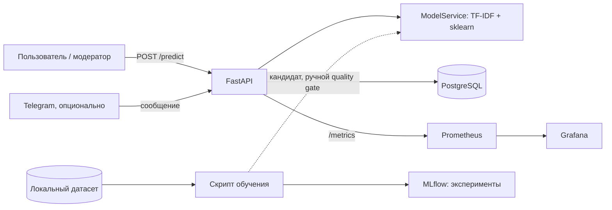

# Team12 — Toxicity Detection: классификация комментариев

Учебный командный проект (УрФУ, поток ПИИ-25, третий семестр). **Цель:** автоматически отнести текстовый комментарий к одному из трёх классов и дать модератору/пользователю прозрачный результат с вероятностями. Это **прототип поддержки модерации**, а не автоматическая система блокировок или готовый промышленный сервис.

> **Демонстрация за 5 минут:** [инструкция для Mac/VS Code](README_LOCAL_CHECK_RU.md) · [FastAPI `/docs`](http://127.0.0.1:8000/docs) · [схема системы](docs/ARCHITECTURE_RU.md) · [матрица соответствия критериям](docs/SUBMISSION_CHECKLIST_RU.md). Если порт `8000` занят, задайте `API_HOST_PORT=18000` в `.env` и используйте этот порт для браузера.

## Задача, вход и выход

- **Вход:** JSON `{"text":"Текст комментария"}` в FastAPI `/predict` или текст в Telegram-боте (бот опциональный).
- **Выход:** `label` (`neutral`, `offensive`, `toxic`), `probabilities` по трём классам и `model` (название алгоритма). Поля и коды ошибок — в [контракте API](docs/API_CONTRACT_RU.md).
- **Важно про разметку:** исходные метки `NORMAL → neutral`, `INSULT`/`OBSCENITY → offensive`, `THREAT → toxic`. Термин «toxic» здесь *операционный*: это **класс угроз** из исходного датасета, а не все нежелательные высказывания вообще.
- **Сценарий:** фильтрация и приоритизация сообщений для ручной модерации. Предсказания нельзя использовать как единственное основание для санкций.

## Результаты и ограничения

- Проверен исходный набор: **248 290** строк, однозначно размечены **239 957**, после нормализации/удаления дублей **239 900**. **8 333 многометочные записи** исключены исходным single-label парсером. Разбиение **167 930 / 35 985 / 35 985** (train/val/test), seed `42`, SHA-256 исходного распакованного TXT сверяется с метаданными baseline.
- Baseline — **TF-IDF + Logistic Regression**: **test macro-F1 0,857169**, **recall класса toxic 0,880342**, accuracy **0,943254**. Это оценка на *одном фиксированном test*, не гарантия качества на новых данных.
- Три варианта экспериментов: **Naive Bayes**, **Logistic Regression**, **Linear SVM (SGD) с калибровкой**. При локальном запуске на Mac в MLflow зарегистрированы три candidate-run, один champion и ранее импортированный baseline. На **Python 3.12 / scikit-learn 1.9.1** champion Logistic Regression показал **test macro-F1 0,857169** и **toxic recall 0,880342** — **без улучшения** относительно baseline. Поэтому автоматического обновления модели нет.
- Результаты прежнего *офлайн*-прогона (Python 3.13 / sklearn 1.8.0) отличаются на ~0,0013 macro-F1: не смешивайте их с последней локальной проверкой. См. [эксперименты и версии](docs/EXPERIMENTS_RU.md), [валидацию данных](docs/DATA_CARD_RU.md) и [ограничения](docs/TEST_PLAN_RU.md).

## Архитектура и стек



**Почему эти компоненты:** `scikit-learn` и TF-IDF — воспроизводимый понятный baseline для текстов; FastAPI — HTTP-контракт и Swagger; PostgreSQL — хранение версий/результатов; Docker Compose — повторяемый локальный запуск; MLflow — параметры, метрики и артефакты; Prometheus/Grafana — технические и агрегированные модельные показатели. Подробнее — [архитектура](docs/ARCHITECTURE_RU.md).

## Структура репозитория

| Путь | Назначение |
|---|---|
| `app/` | Исходный FastAPI, опциональный Telegram-бот, `ModelService`, PostgreSQL, API-тесты |
| `mlops/` | Аудит датасета, импорт baseline, обучение, проверка MLflow |
| `notebooks/01_quality_evaluation.ipynb` | Оценка качества и матрица ошибок |
| `notebooks/02_robustness_testing.ipynb` | Тесты устойчивости и задержек |
| `reports/` | Выполненные ноутбуки, агрегированные метрики и результаты на реальных данных (без текстов сообщений) |
| `artifacts/` | Доверенный baseline `joblib`, метаданные и сохранённые CSV; локальные кандидаты не публикуются автоматически |
| `tests/`, `app/tests/` | Автоматические проверки и интеграционные тесты с изолированной БД |
| `compose.yaml`, `Dockerfile`, `.github/workflows/ci.yml` | Контейнеризация и CI |
| `monitoring/` | Prometheus, Grafana, rules алертов |
| `docs/` | Контракты, архитектура, стратегия деплоя, эксперименты, тест-план, риски |

## Как запустить и проверить (macOS + VS Code)

Требуются **Python 3.12**, **Docker Desktop** и свободные порты. В корне проекта:

```bash
bash scripts/local_validate.sh setup
# Если порт 8000 занят: в локальном .env задайте API_HOST_PORT=18000
bash scripts/local_validate.sh infra
bash scripts/local_validate.sh status
bash scripts/local_validate.sh tests
bash scripts/local_validate.sh mlflow
# Только при наличии приватного data/dataset.txt.zip:
bash scripts/local_validate.sh train-all
bash scripts/local_validate.sh compare
```

После запуска Swagger доступен по `http://127.0.0.1:${API_HOST_PORT:-8000}/docs` (подставьте выбранный порт вручную в браузере); MLflow — `http://127.0.0.1:5000`, Prometheus Targets — `http://127.0.0.1:9090/targets`, Grafana — `http://127.0.0.1:3000` (учётные данные — **только в локальном `.env`**). Для демонстрации одного запроса:

```bash
curl -X POST http://127.0.0.1:18000/predict -H 'Content-Type: application/json' -d '{"text":"Привет, хорошего дня!"}'
```

В примере выше порт `18000`, который использовался при локальной проверке команды. Если у вас выбран другой порт, измените адрес в `curl`.

**Проверено командой на Mac (20.11.2026):** Docker Compose — шесть сервисов запущены, Prometheus `toxicity-api` **UP (1/1)**, Grafana показывает доступность, запросы, p95 задержки и распределение классов. **13/13** дополнительных и **19/19** интеграционных тестов с настоящей изолированной PostgreSQL прошли. MLflow зарегистрировал пять запусков. В репозитории это зафиксировано как **предоставленные командой логи и скриншоты**, а не как независимо воспроизведённая проверка CI: [протокол](docs/LOCAL_VERIFICATION_RU.md).

Подробно: [локальный запуск](README_LOCAL_CHECK_RU.md) · [тест-план](docs/TEST_PLAN_RU.md) · [стратегия деплоя](docs/DEPLOYMENT_STRATEGY_RU.md) · [мониторинг и алерты](docs/MONITORING_PLAN_RU.md).

## Безопасность, ограничения и этика

Исходный датасет исключён из публичного GitHub (`data/` в `.gitignore`), поскольку происхождение/права распространения и наличие персональных данных требуют проверки. Текущая БД сохраняет **сырой текст**, поэтому для реального использования необходимы политика сроков хранения, доступ по ролям, обезличивание и согласование правовой основы обработки. У модели есть дисбаланс классов и пробел в многометочной разметке; дрейф тематики/лексики и ошибочное маркирование возможны. MLflow и Grafana доступны только локально; публичный деплой потребует HTTPS, аутентификации, rate limit и резервного копирования. Автоматическая модерация без человека **не предусмотрена**.

## Команда и вклад

Указанные в исходном README роли (проверьте их с участниками перед сдачей):

| Участник | Зона ответственности |
|---|---|
| Баженов Егор | Архитектура и сервис |
| Марина Полина | Эксперименты и данные |
| Александр Филипов | Тестирование и деплой |
| Громова Виктория | Отчёт и презентация |

**Безопасность публикации:** исходный датасет и локальные секреты исключены из репозитория. Порядок проверки — в [документации](docs/PUBLICATION_SAFETY_RU.md).


**Материалы защиты:** отчёт **5–7 страниц** и презентация **10–15 слайдов** готовятся командой отдельно. [Чек-лист сдачи](docs/SUBMISSION_CHECKLIST_RU.md).
