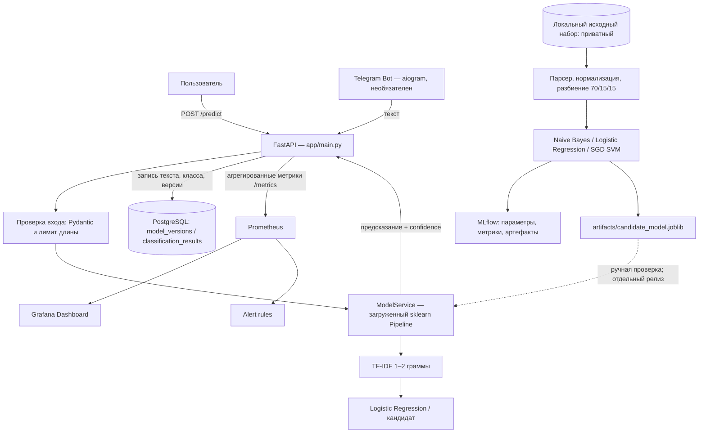

# Архитектура Team12 Toxicity Detection

## Границы и потоки данных

1. **Online**: HTTP или Telegram отправляет один текст; API валидирует его, вызывает загруженную локально sklearn-модель, возвращает метку и вероятности, сохраняет результат в PostgreSQL. Ошибка сохранения БД протоколируется, но ответ API может быть успешным; готовность `/health/ready` отдельно проверяет БД.
2. **Offline**: датасет остаётся локальным. Парсер сводит `NORMAL/INSULT/OBSCENITY/THREAT` к трём классам, выполняет воспроизводимое разделение и обучение. Каждый вариант пишет validation-метрики в MLflow; выбранный **по validation** champion оценивается на holdout test. MLflow **не вызывается** при пользовательском предсказании.
3. **Наблюдаемость**: Prometheus опрашивает `/metrics` **по Docker-сети `api:8000`**, даже если внешний порт на Mac — `18000`. Grafana читает Prometheus и отображает доступность, скорость предсказаний, p95 латентности и долю предсказанных классов. Никакие сырые тексты не включаются в Prometheus labels.
4. **Хранение**: PostgreSQL содержит `model_versions` (имя/версия) и `classification_results` (сырой текст, предсказанный класс, confidence, источник, опционально ручная метка `true_class`). Риски персональных данных описаны в [карте данных](DATA_CARD_RU.md).
5. **Контуры**: `db_test` — отдельный временный PostgreSQL, включается профилем Compose `test` и не содержит данных основного `db`; MLflow включается профилем `mlflow` и не нужен для API inference.

## Обоснование решений и trade-offs

| Компонент | Почему выбран | Ограничение |
|---|---|---|
| TF-IDF + scikit-learn | Понятный проверяемый baseline, быстро работает на CPU | Не учитывает глубоко семантику/контекст |
| FastAPI + Pydantic | Чёткий JSON-контракт, автоматический Swagger | Нет встроенной аутентификации/лимита запросов |
| PostgreSQL | Структурированное хранение версий, результатов и ручной разметки | Сырой текст требует политики хранения и доступа |
| Docker Compose | Воспроизводимая локальная инфраструктура | Не является автоматическим production-оркестратором |
| MLflow | Сравнение параметров, метрик и артефактов | Нужны контроль доступа и управление объёмом артефактов |
| Prometheus + Grafana | Доступность, ошибки, задержки, распределение ответов | Нет онлайн-истины для расчёта F1 без разметки |

**Фактическое использование:** один worker API при включённом Telegram polling, чтобы не создавать несколько ботов. Production-деплой требует отдельного планирования HTTPS, доступа, бэкапов и откатов. См. [стратегию деплоя](DEPLOYMENT_STRATEGY_RU.md).
